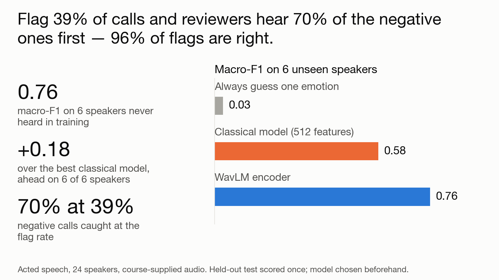
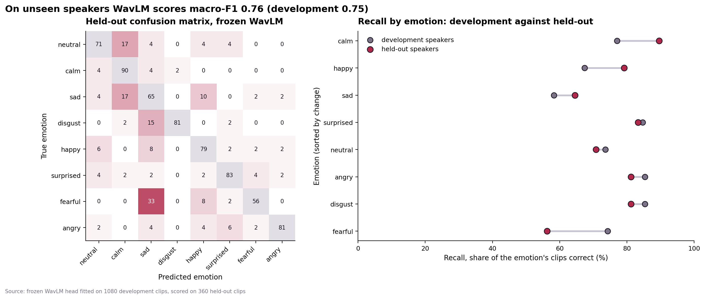
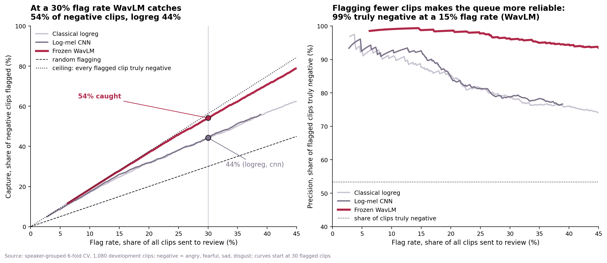
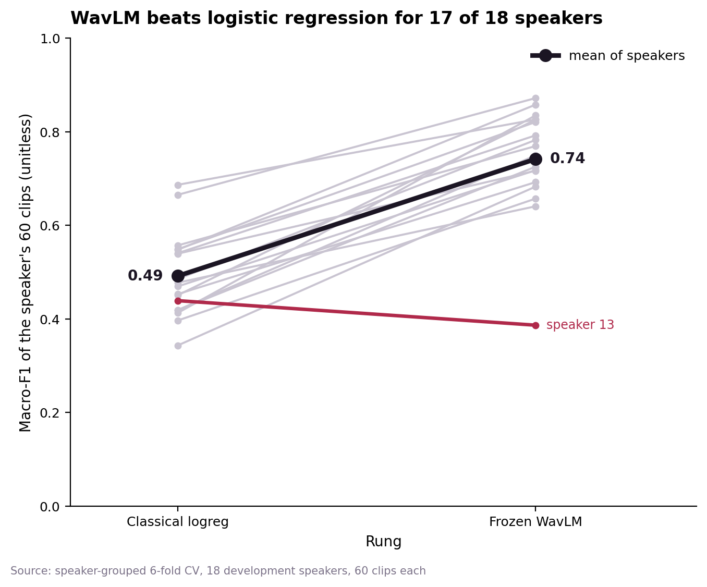

# Speech Emotion Recognition → a QA review flag

**A reviewer can't hear every call. Which ones should they hear first?**

- **Situation.** A quality-assurance reviewer can only listen to a small share of customer calls. Calls where the speaker sounds angry, fearful, sad or disgusted are the ones most worth hearing, but nobody knows which they are until someone listens.
- **Task.** Turn a speech-emotion model into a review flag: which calls go to the front of the queue, how many to flag, and whether that rule still works on voices the model has never heard.
- **Action.** Compared a guess-one-emotion baseline, a classical model on 512 acoustic features, and a frozen public speech encoder (WavLM) with a simple classifier on top. Tuned and chose the model on 18 development speakers, fixed the choice and the pass bars in writing, then scored 6 held-out speakers once. Set a confidence threshold on the development speakers that flags 30% of clips, and tested it on the held-out ones.
- **Result.** On 6 speakers never heard in training the encoder scores a macro-F1 of **0.76** (95% interval 0.65 to 0.85), against **0.58** for the best classical model and **0.03** for always guessing one emotion. It is ahead of the classical model on **6 of 6** held-out speakers. The flag rule sends **39%** of clips to review, catches **70%** of the negative-emotion ones, and **96%** of flagged clips are truly negative.
- **The trade-off.** The flag rate drifted from the 30% set on development speakers to 39% on new ones, so the threshold must be re-set for each new speaker pool.

> **Data and honesty**
> - This is acted speech, not real customer calls. The call-centre use is the decision framing; the data does not come from calls.
> - 1,440 clips from 24 speakers, supplied by the course and not included in this repo.
> - Team project, ISB AMPBA 2026.
> - The speech encoders are public and frozen, not fine-tuned. Only the emotion classifier on top is trained here.
> - **The held-out result is one estimate from six speakers, so the interval is wide.**



*The whole decision in one picture. The three figures below repeat it with the detail.*

| | | |
|---|---|---|
| **0.76** | **+0.18** | **70% at 39%** |
| macro-F1 on 6 speakers never heard in training | over the best classical model, ahead on 6 of 6 speakers | negative calls caught at the flag rate |

---

## Does it hold on new voices?



*Left: what the model predicted for each true emotion on the 360 held-out clips. Right: recall by emotion, development against held-out.*

- Held-out macro-F1 is **0.76**, inside the development band of 0.71 to 0.80 that was written down before scoring (`Evaluation/model_choice.md`).
- The 95% interval resamples speakers and runs from **0.65** to **0.85**: six speakers is a small sample.
- Fearful is the weak spot: a third of fearful clips are read as sad.
- **So what.** The development estimate carried over to new speakers, but quote it with its interval, not as a single number.

## Turning a prediction into a review flag



*Both panels use the development speakers (6-fold, speaker-grouped). A clip is flagged when the model predicts angry, fearful, sad or disgust with confidence at or above the threshold.*

- At a **30%** flag rate on development speakers, the encoder catches **54%** of negative clips; the classical model catches 44%.
- The threshold fixed there is **0.827**.
- On the held-out speakers the same threshold flags **39%** of clips, catches **70%** of the negative ones, and **96%** of flags are right.
- Flagging fewer clips makes the queue more reliable: 99% of flags are truly negative at a 15% flag rate.
- **So what.** The flag is a queue-ordering tool. The reviewer chooses how many to hear; the threshold sets how reliable that queue is.

## Where the encoder beats the classical model



*Each grey line is one development speaker. The red line is the one speaker the encoder does worse on.*

- The encoder beats the classical model for **17 of 18** development speakers; the mean moves from 0.49 to 0.74.
- On the held-out speakers it is ahead on **6 of 6**, a gain of **+0.18** macro-F1.
- **So what.** The gain is not carried by a few voices, but one speaker still loses, so a new pool can contain one the model handles badly.

## What this does not show

- **Acted speech, not calls.** Real calls have noise, compression, overlapping talk and subtler emotion. Performance there is untested.
- **Six held-out speakers.** The interval (0.65 to 0.85) is wide, and one unusual voice can move the score by several points.
- **The flag threshold is not stable.** It flagged 30% on development speakers and 39% on held-out ones; the pre-registered bar for this was only partly met.
- **No cost model.** The share of calls a reviewer can hear, and the cost of a missed negative call, are not estimated here.
- **Frozen encoders only.** Fine-tuning was not tried.

## Terms, in plain English

<details>
<summary>Six terms this project leans on</summary>

- **Macro-F1** — a single score from 0 to 1 that averages how well the model does on each of the eight emotions equally, so rare emotions count as much as common ones.
- **Held-out speakers** — people whose voices were set aside and never used to build or choose the model. They show how it behaves on new callers.
- **Frozen encoder (WavLM)** — a public speech model trained by others on large amounts of audio. Here it only turns each clip into numbers; its own weights are not changed.
- **Capture** — of all the truly negative-emotion calls, the share the flag sends to review.
- **Precision** — of all the calls the flag sends to review, the share that really are negative.
- **Flag rate** — the share of all calls sent to review.

</details>

## Try it

The audio is not included, so the notebooks are saved with their outputs and can be read as they are. To rebuild the case-study numbers and decision image from the saved tables:

```bash
pip install pandas matplotlib
python3 analysis/make_case_study.py
```

To re-run the full notebooks, see **[docs/HOW_TO_RUN.md](docs/HOW_TO_RUN.md)**.

## Repo layout

```
EDA and Feature engineering/   notebooks 01-02, the 512 acoustic features
Modelling/                     notebooks 03-05, classical models, CNN, pretrained encoders
Evaluation/                    notebooks 06-08, error analysis, flag rule, held-out test, model_choice.md
shared/                        helper code and the frozen speaker split
analysis/                      make_case_study.py (summary.json + decision image) · viz.py
outputs/                       summary.json: every number quoted above
figures/                       the decision image and the three charts above
docs/                          HOW_TO_RUN.md
```

**Author:** Akash Sood · ISB AMPBA · [portfolio](https://akash-sood97.github.io) · [GitHub](https://github.com/akash-sood97)
